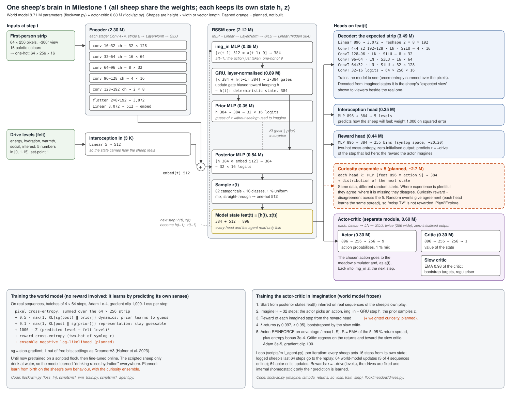

# Milestone 1 — the meadow

Plan: [`03-implementation-plan.md`](03-implementation-plan.md#milestone-1--meadow-drives-and-world-model).
Model diagram: [`m1-model.svg`](m1-model.svg). Logs, evaluation numbers and figures behind every
result here: [`m1-results/`](m1-results/) (copied from the local runs, which are not in git).

| Step | Status (2026-10-24) |
| --- | --- |
| 1. Meadow sim, first-person views, viewer, scripted flock | Done. |
| 2. Logged rollouts, world-model pretraining | Done; surprise not yet selective. |
| 3. Drives and the actor-critic in imagination | Built and tested. No sheep learning from vision through the world model beats a random flock yet (seven runs); privileged PPO beats the scripted flock, so the meadow is learnable (§ After the review). |
| 4. Behavioural and stability evaluation | Not started. |

# Step 1 — sim, first-person views, viewer, scripted flock

This step builds the world the rest of M1 learns in; nothing is learned yet.

## What exists (`flock/meadow/`)

| File | What it does |
| --- | --- |
| `world.py` | State and generator: a 128×128 tile ground (grass biomass 0–3, shown as the four grass states; water tiles in two or three ponds) and continuous objects — a treeline along the north edge plus copses, three huts, the salt lick, flowers and mushrooms — and a flock of 40 with float positions and headings. |
| `sim.py` | One step for the whole flock: the owner's actions (turn left/right 22.5°, walk 0.12 or trot 0.35 tiles, stop, graze, drink, rest, head up); moves refused into water, off the meadow or into trees, huts and the salt lick; overlapping sheep pushed apart; grazing eats biomass, grass regrows; drinking within one tile of water; a day of 1,200 steps, the last 40 % night. |
| `views.py` | Every sheep's first-person strip (`flock/fpv.py`, 256×64, ~300°): its 48 nearest objects and sheep as billboards, other sheep facing how they move relative to the viewer; range 12 tiles by day (16 head up), 5 at night (8 head up); dark sky and far ground at night. |
| `scripted.py` | A rule-based flock (privileged, not learned): shelter and rest near cover at night, drink when thirsty, graze when hungry (moving to richer grass nearby), otherwise wander with cohesion. For watching now and for the world model's logged rollouts in step 2. |
| `viewer.py` | The human display: an isometric window following the flock (continuous positions, sheep facing their heading, darker at night), one sheep's strip and a status line. |

Scripts: `scripts/m1_watch.py` (runs the scripted flock and writes `watch.gif` and stills),
`scripts/m1_profile.py` (throughput). Tests: `tests/test_meadow.py`, `tests/test_fpv.py`.

```bash
python scripts/m1_watch.py --out runs/m1/watch --steps 2400 --every 12
python scripts/m1_profile.py
```

## Profile (RTX 4080, scripted flock of 40, 100-step scans, 5 repetitions)

| meadows | agent-steps/s without views | agent-steps/s with every sheep's view |
| --- | --- | --- |
| 1 | 1.0 M | 58,000 |
| 8 | 1.9 M | 287,000 |
| 32 | 2.6 M | **322,000** |
| 64 | (12.9 M — anomalous, not trusted) | 177,000 |

Rendering every sheep's view dominates, and throughput peaks around 32 meadows (64 is slower,
plausibly memory pressure). At ~320,000 agent-steps/s the plan's ~10⁷ logged steps for
world-model pretraining are under a minute of simulation, so the simulation will not limit M1.

## What the scripted flock looks like (2,400 steps, two days)

Stills: [`m1-results/scripted_watch_day.png`](m1-results/scripted_watch_day.png),
[`m1-results/scripted_watch_night.png`](m1-results/scripted_watch_night.png) (isometric window,
the followed sheep's strip below, status line with the drive levels).

By day the flock grazes and wanders together, eats visible patches of grass down near where it
feeds, and goes to water when thirsty; at night it gathers among trees and rests (42 % resting
early in the night, 90 % by dawn); after the night's fast thirst is high (0.86 on average at
dawn) and the flock heads back to water. First fixes were needed (recorded here because they
will matter for learned sheep too): refusing any move that brought two overlapping sheep closer
froze a dense flock, so overlaps are now pushed apart instead; the bookkeeping needs rose too fast
for the day length; and a single nearest tree became a queue, so each sheep now has a stable
preference among nearby cover.

## Known issues and open choices

- **Billboard scale: 24 px per tile** (owner, 2026-10-23). At the isometric art's 16 px per tile
  a sheep was ~1.4 tiles tall against a 0.5-tile eye and any neighbour filled the view; now a
  sheep is ~0.9 tiles tall and neighbours at ordinary spacing look like sheep among sheep. A
  neighbour *touching* the viewer (~0.6 tiles, e.g. in the night huddle) still fills the strip,
  which is what the geometry gives.
- Ground right in front of the viewer is the tile art magnified (blocky).
- The scripted flock's thirst and hunger are bookkeeping for the script only; the learned
  drives arrive in step 3.
- The display is a GIF written by a script, not yet a live window.

# Step 2 — logged rollouts and world-model pretraining (2026-10-23)

**Data** (`flock/meadow/rollouts.py`, `scripts/m1_log.py`): four shards of the scripted flock,
each 32 fresh meadows × 8 recorded sheep × 1,024 steps from a random time of day after a 200-step
warm-up — 1.05 M first-person strips with the action taken after each, packed 4 bits per pixel
(8 GB, on the WSL filesystem: `~/flock2_data/m1_rollouts`). Logging takes ~40 s in all.

**Model** (`flock/wm.py`): a DreamerV3-style world model
([Hafner et al. 2023](https://arxiv.org/abs/2301.04104)) — five stride-2 convolutions over the
one-hot strip (64×256 → 2×8), a layer-normalised GRU deterministic state (384) and 32 categorical
latents of 16 classes (1 % uniform mix, straight-through samples), the action entering the
transition, a mirrored decoder over the 16 colours, per-pixel cross-entropy summed over the strip
and KL balancing (0.5 dynamics / 0.1 representation, 1 nat free bits) as in the paper.
7.9 M parameters. Trained with Adam 1e-4 on batches of 4 sequences × 64 steps — DreamerV3's
pixels per batch (16 × 64 at 64×64); 8 × 64 ran out of the 4080's 16 GB. 20,000 steps in ~30 min
(`scripts/m1_wm_train.py`; checkpoint `~/flock2_data/m1_wm/run1/model.pkl`).

**Open-loop test on the held-out shard**: observe 16 strips, then imagine 48 from the true actions
alone (16 fixed windows):

| steps ahead | pixel accuracy | object-pixel recall (sheep, trees, huts, …) |
| --- | --- | --- |
| 1 | 0.87 | 0.75 |
| 4 | 0.83 | 0.68 |
| 16 | 0.70 | 0.56 |
| 32 | 0.63 | 0.50 |
| 48 | 0.57 | 0.49 |

Long horizons are noisy between evaluations (16 windows). By eye (`runs/m1/wm_run1/open_loop_020000.png`):
near sheep keep their legs and faces, distant sheep survive as small white shapes rather than
being erased (the IRIS-style failure the plan's criterion guards against), and imagined frames
bring plausible sheep into view; small trees and flowers are still often lost.

**Surprise** (`scripts/m1_wm_surprise.py`: KL(posterior ‖ prior) per step on held-out sequences):
routine mean 28 nats per step, 99th percentile 64. A teleport — half-way through a sequence the
strips switch to a sheep in another meadow — gives 86, about 3× the routine mean, falling back
to routine within five steps; but that is only 1.3× the routine 99th percentile, so routine viewing
has frequent peaks of similar size. Surprise follows information: turning is the most surprising
action (~37; new parts of the panorama come into view), resting (20) and night (19 vs 28 by day)
the least, and dawn — the sky switching from dark to light — gives one of the largest spikes:
the model has no clock and cannot anticipate it.

Against the plan's world-model criteria *(judgement)*: small distant objects are kept (partly met;
recall ~0.5 at long horizons); surprise rises on genuine novelty but is not yet *selective* — the
routine peaks are close to the teleport. Not blocking for step 3; worth revisiting with more data
(the plan's 10⁷ steps) and a longer run before M1's evaluation.

Evidence: `m1-results/wm_run1_log.jsonl`, `wm_run1_open_loop_020000.png` (three held-out
sequences; actual strip above, imagined below, at 1, 4, 16 and 32 steps ahead),
`surprise.json`, `kl_trace.png`, `kl_teleport.png`.

# Step 3 — drives, interoception, reward and the actor-critic (2026-10-23/24)

Summary: the drives work (the scripted flock keeps them up); the world model learns to feel and
predict them and, after two changes, predicts the reward accurately (15-step sum correlation 0.90,
unbiased). The actor-critic has not yet learned useful behaviour in three runs. A probe shows why:
pretrained only on the scripted flock, the world model believes drinking raises hydration
anywhere, because the scripted sheep only ever drink at the water's edge — and the actor exploits
that belief faster than online training corrects it. The agreed next step is to learn from birth
on the sheep's own behaviour with a curiosity drive (§ Next).

## Drives (`flock/meadow/drives.py`)

Five internal levels per sheep, set-point 1, clipped to [0, 1.15] (overshoot allowed, and counted
as deviation, so over-eating is penalised):

| Level | Falls per step | Restored by |
| --- | --- | --- |
| energy | by action since 2026-10-24: rest 0.0003; stop, graze, drink, head up 0.0005; turn 0.0006; walk 0.0008; trot 0.0016 (was a flat 0.0006 for every action through birth1) | grazing: +0.012 per step on a tile with grass ≥ 1 (of 3); the bite (0.05) is removed from the tile, which regrows |
| hydration | 0.0008 | drinking within one tile of water: +0.04 per step |
| warmth | 0.0002 by day; at night 0.0016 in the open, 0.0007 within 3 tiles of a tree or hut | resting only: +0.003, +0.006 beside cover |
| social | — (instantaneous, not a store) | number of other sheep in view (in range, outside the blind wedge) / 8, capped at 1 |
| interest | 0.0004 | entering an 8×8-tile cell of the meadow: +0.08 / √(1 + previous visits by this sheep), blind to other sheep |

The drive is D = (Σ|1 − hᵢ|⁴)^(m/4) — close to the worst deficit, so topping up a small deficit
is worth less than fixing the largest one (the non-substitutable form the survey calls for, after
[Keramati & Gutkin 2014](https://elifesciences.org/articles/04811)). **m = 2 from birth3**, as the
paper requires (n > m > 1), so the drive grows as the square of a single deficit; through birth2
it was m = 1, the plain L4 norm (§ birth3). Also from birth3, an innate **bad taste** for
ingesting nothing costs 0.05 per mouthful (§ birth3). Rates were chosen so that a
sensible flock can keep up with them over the 1,200-step day *(judgement)*. The scripted flock,
given hysteresis (top up to 0.95 once started), keeps the *mean* levels up: over its third day
from dawn (8 meadows × 40 sheep, `scripts/m1_scripted_check.py`) energy 0.66, hydration 0.53,
warmth 1.05, social 0.94, interest 0.79 with the flat energy use, and 0.66 / 0.54 / 1.06 / 0.95
/ 0.82 with the per-action use. **Correction (2026-10-24):** this README earlier said the
scripted flock holds the levels "indefinitely"; that was true of the means only. Its struggling
tenth does not: the 10th percentile of energy reaches 0 by day 3 and of hydration by the first
night, under either energy use. So the drives are survivable on average and the script loses
some sheep (queueing at grass and water, or its hunger threshold of 0.3, are the likely causes;
not investigated). Tests: `tests/test_meadow.py` (reward signs,
night chill in the open vs cover, social counts only sheep in view, interest pays for new cells).

**Reward.** First Keramati & Gutkin's drive reduction, r = 100·(D_t − D_{t+1}) (the ×100 as in
the deep-HRRL work the research notes cite). **Now r = −D_{t+1}** (owner's decision after agent
run 1, below). The two rank policies the same way: Keramati & Gutkin prove that maximising
discounted drive reduction equals minimising discounted drive, and directly
Σₜ γᵗ(D_t − D_{t+1}) = D₀ − ((1 − γ)/γ)·Σ_{t≥1} γᵗ D_t. But drive reduction carries the signal at
a scale of (1 − γ) ≈ 0.003, is flat once the levels bottom out (nothing more can be lost), and its
per-step value is dominated by rare spikes when a sheep drinks or grazes.
`drives.drive_reduction` keeps the old form.

Rollouts were re-logged with the levels and the reward: `~/flock2_data/m1_rollouts_drives`, four
shards as in step 2 plus `levels` (float16) and `reward` per step; shard 3 held out. The trainer's
`--reward_from_levels` recomputes the reward from the logged levels with the current formula.

## World model with interoception and a reward head (`flock/wm.py`)



Additions to step 2's model:

- **Interoception in**: the five levels pass through a linear layer (5 → 512) added to the
  strip's embedding before the posterior, so the model's state includes how the sheep feels.
- **Interoception out**: an MLP head (896 → 384 → 5) reconstructs the levels from the state
  (h, z), weighted 1,000 on the summed squared error (the strip's cross-entropy sums 16,384
  pixels, ~3,600 nats per frame).
- **Reward head** (DreamerV3's form, [Hafner et al. 2023](https://arxiv.org/abs/2301.04104)): an
  MLP (896 → 384 → 255) giving a categorical over 255 bins evenly spaced in symlog space on
  [−20, 20], trained by cross-entropy against the two-hot encoding of symlog(reward), output layer
  zero-initialised; the prediction is symexp of the expected bin. The state at t+1 predicts the
  reward of the step taken at t.

Each fine-tune starts from the previous checkpoint (`wm.load_into` loads the matching parameters;
new parts start fresh); batches of 4 × 64 steps, Adam 1e-4. Evaluation is step 2's open-loop test
(observe 16, imagine 48 from the true actions) plus the reward the actor-critic would see: the
imagined reward summed over the next 15 steps against the true sum.

| Run | What changed | Steps | Level error h1 / h48 | Reward: 1-step corr. / 15-step-sum corr. / 15-step mean true vs predicted | Pixel acc. h1 / h48 |
| --- | --- | --- | --- | --- | --- |
| run2 | + interoception; reward computed from the predicted levels through the drive formula | 10,000 | 0.064 / 0.12 | 0.01 / **0.28** / −0.07 vs **−3.45** | 0.87 / 0.59 |
| run3 | + reward head, drive-reduction reward | 10,000 | 0.043 / 0.11 | 0.57 / 0.75 / −0.07 vs −0.22 | 0.87 / 0.59 |
| run4 | reward head retrained on r = −D | 6,000 | 0.043 / 0.10 | 0.93 / **0.90** / −9.44 vs **−9.49** | 0.88 / 0.60 |

(run2's row is from `--eval_only 64`, 64 held-out windows; runs 3 and 4 evaluate 64 windows each
time. Level error is the mean absolute error per drive. Logs: `m1-results/wm_run{2,3,4}_log.jsonl`;
`wm_run4_open_loop_006000.png`.) Reading *(judgement)*: computing the reward from predicted levels
fails because small level errors swamp the tiny per-step changes the reward is made of, and the
imagined levels drift (the model imagined the drives always worsening); a direct reward head
removes most of the bias; −D is a smooth function of the felt levels and far easier to predict
than drive-reduction spikes. Vision is unaffected by the additions.

## Actor-critic in imagination (`flock/ac.py`)

DreamerV3's recipe ([Hafner et al. 2023](https://arxiv.org/abs/2301.04104)):

- Actor and critic: separate MLPs on the model state (896 → 256 → 256 → out, layer norm, SiLU,
  zero-initialised output; ~0.3 M parameters each). Actor: categorical over the nine actions
  with a 1 % uniform mix. Critic: scalar value; a slow copy (EMA 0.98) gives the bootstrap
  targets and a regulariser.
- Imagination: from model states inferred on real sequences, roll the prior forward H steps with
  actions sampled from the actor; rewards from the reward head. The world model is frozen here.
- Targets: λ-returns (γ 0.997, λ 0.95) bootstrapped by the slow critic. Actor: REINFORCE on
  advantages divided by max(1, S), S an EMA (0.99) of the 5th–95th percentile spread of the
  returns, plus an entropy bonus. Adam 3e-5, gradient clip 100.
- Tests (`tests/test_ac.py`): λ-returns against a hand computation; an update changes only the
  agent, never the world model.

## The online loop (`scripts/m1_agent.py`)

Every sheep in every meadow acts from the shared actor, from its own model state (h, z) updated
each step with its strip and its levels (a per-sheep posterior filter, as the world model runs in
training). Each iteration: act for `--collect` steps; push the logged sheep's sequences to a
replay; `--wm_steps` world-model updates mixing online sequences with scripted shards (so the
model keeps what it learned there); `--ac_steps` actor-critic updates from start states inferred
on online sequences. Logged per iteration: mean reward, levels, the day and night action mix and
the losses (`scripts/m1_agent_report.py` summarises a run). The update steps are compiled before
the first acting step (XLA autotuning ran out of GPU memory otherwise).

## Agent runs

Flock of 40 per meadow, 8 sheep per meadow logged to the replay.

| Run | Reward (world model) | Per iteration | Horizon | Entropy | Outcome |
| --- | --- | --- | --- | --- | --- |
| 1 | drive reduction (run3) | 16 meadows × 64 steps; 16 WM updates (2 of 4 sequences online), 16 AC | 15 | 3e-4 | **Collapse.** By iterations 91–100, 83 % of actions are *drink*, the same by day and night; water, warmth and interest at 0; entropy 2.2 → 0.6. Stopped at 116. |
| 2 | −D (run4) | as run 1 but 48 WM updates (3 of 4 online) | 15 | 3e-3 | **No learning.** Policy stays uniform (entropy 2.196 → 2.183 over 530 iterations, 45 min) while every drive runs down; reward −1.15 → −1.34 per step. The return spread S ≈ 11.6 dwarfs any action's effect. |
| 3 | −D (run4) | 4 meadows × 16 steps; each logged sheep's last 64 steps enter the replay every iteration (sliding window); 64 WM (3 of 4 online), 64 AC | 32 | 3e-4 | **Collapse again.** *Drink* 0.12 → 0.72 of actions by iteration 50; water 0.63 → 0.14; imagined reward −0.63 against real −0.91. Stopped at 52. |

Per-iteration logs: `m1-results/agent_run{1,2,3}_log.jsonl`.

## Why: the probe (`scripts/m1_wm_probe.py`)

Fresh daytime meadows (8 × 40 sheep, none of them at the water's edge), scripted flock warmed up
300 steps; each sheep's model state is inferred from its last 16 strips and levels, then the model
imagines 8 steps of repeating one action while the simulator really does it from the same state:

| Model | Action | Δ hydration predicted / true | Δ energy predicted / true | Mean reward predicted / true |
| --- | --- | --- | --- | --- |
| run4 (pretrained) | drink | **+0.160** / −0.006 | −0.002 / −0.005 | **−0.507** / −0.550 |
| | graze | +0.025 / −0.006 | +0.061 / +0.071 | −0.532 / −0.547 |
| | stop | +0.026 / −0.006 | +0.033 / −0.005 | −0.538 / −0.550 |
| | walk | −0.010 / −0.006 | −0.007 / −0.005 | −0.574 / −0.550 |
| agent run 3 after 50 iterations | drink | +0.032 / −0.006 | +0.019 / −0.005 | −0.533 / −0.550 |
| | graze | −0.032 / −0.006 | +0.071 / +0.071 | −0.552 / −0.547 |
| | stop | −0.035 / −0.006 | +0.032 / −0.005 | −0.560 / −0.550 |
| | walk | −0.023 / −0.006 | −0.007 / −0.005 | −0.560 / −0.550 |

(`m1-results/probe_drink.json`.) The pretrained model believes drinking on dry ground raises
hydration by half of what drinking at water would give (+0.04 per step, +0.32 over 8 steps at
these sheep's mean hydration of 0.50); drinking is the action it rates best, while in reality it is worth no more than standing
still. Online training shrinks the false belief but has not removed it after 50 iterations, and
*drink* still rates best. (It also believes stopping raises energy.) The cause is the data, not
the model: in the scripted rollouts *drink* happens only at the water's edge, so "drinking raises
hydration" and "drinking at water raises hydration" cannot be told apart. Run 2 hid the problem
only because its high entropy kept the policy from acting on anything.

## The change of approach — agreed with the owner (2026-10-24)

The owner's framing: in an animal, world model and behaviour are learned together from its own
experience, with the reward circuitry built in rather than learned. The sheep already match this
in two respects: the drives are a fixed, internal reward (homeostatic regulation,
[Keramati & Gutkin 2014](https://elifesciences.org/articles/04811)), and the world model learns
only by predicting its own senses, with no reward of its own; what is learned about reward is its
*prediction* (the critic, the reward head), as in the reward-prediction-error account of dopamine
([Schultz, Dayan & Montague 1997](https://www.science.org/doi/10.1126/science.275.5306.1593)). The
departure is the scripted pretraining, which acts as an external teacher and is the source of the
bug.

The plan *(judgement; not yet built or tested)*:

1. **Learn from birth.** Drop scripted pretraining (or keep only a short "infancy"); world model
   and policy learn together from the sheep's own behaviour.
2. **A curiosity drive from the world model's own uncertainty.** An ensemble of five small heads,
   each predicting the next model state from (h, z, action) — dashed in the diagram — trained on the
   same data from different random initialisations; the sheep is rewarded where they disagree
   (Plan2Explore, [Sekar et al. 2020](https://arxiv.org/abs/2005.05960)). Where data is plentiful
   they agree; where it is missing (drinking on dry ground) each extrapolates in its own way.
   Because each head predicts a *distribution*, genuinely random events (another sheep's wandering)
   give agreement, not reward — the guard against the "noisy TV" trap of rewarding raw prediction
   error. The first try of something new pays most, a confirming retry less, a mastered behaviour
   nothing. Fallback if the heads are awkward: Monte-Carlo dropout, one model run several times
   with random units silenced, a recognised cheap approximation to an ensemble
   ([Gal & Ghahramani 2016](https://arxiv.org/abs/1506.02142)).
3. **Later, if disagreement chases the wrong things: learning progress** — reward the improvement
   in prediction, not its error, so unlearnable noise pays nothing and a mastered thing stops
   paying (the owner's proposal; established as compression progress,
   [Schmidhuber 2010](https://people.idsia.ch/~juergen/ieeetamd2010.pdf), and learning-progress
   motivation, [Oudeyer, Kaplan & Hafner 2007](https://ieeexplore.ieee.org/document/4141061)).

Considered and set aside: measuring how much the output changes under small noise on the input
image — a model can be smooth and confidently wrong, as this one is about drinking, and the
unknown here is the *action*, not the image. The current location-novelty interest drive stays
(it is part of the homeostatic reward); the disagreement reward is the first intrinsic term
outside the drives, which the survey warns can shift set-points (the "palatability" pathology), so
its weight is a measured choice *(judgement)*.

## Learning from birth: birth1 (visual curiosity)

**Built** (`flock/wm.py`, `flock/ac.py`, `scripts/m1_agent.py`): a curiosity ensemble of five
heads on the world model; the actor-critic's imagined reward gains curiosity × disagreement /
(its running mean), so a typical step earns about the weight; `--wm none --scripted none` starts
the world model from random weights with no scripted data; `--ac_start` gives an infancy in which
only the world model learns and the policy is uniform. One design change was forced by a test:
with the action concatenated to the head's input (as Plan2Explore does), 9 action inputs beside
896 state inputs, an action never tried got no more disagreement than a familiar one (5.6e-7 vs
5.6e-7); each head now has a shared hidden layer and one output branch per action, so an untried
branch keeps each head's own random weights and the heads disagree until it is trained
(`tests/test_wm.py`).

**Run** (`m1-results/agent_birth1_log.jsonl`): 4 meadows × 40 sheep, the heads predicting the next
*view* state (z); curiosity 0.1; 300 iterations of infancy, then the actor-critic; replay of 8,192
64-step sequences; otherwise as agent run 3. Stopped at 631 iterations (70 min).

| Iterations | Reward | Water | Warmth | Social | Interest | Energy | What the policy does |
| --- | --- | --- | --- | --- | --- | --- | --- |
| 4–303 (infancy) | −0.89 → −1.24 | 0.20 → 0.03 | 0.62 → 0.10 | 0.60 → 0.13 | ~1.0 | 1.07 → 1.14 | uniform; 99 % of drinks on dry ground |
| 304–403 | −1.25 | 0.02 | 0.08 | 0.12 | 0.96 | 1.14 | near-uniform; *drink* stays at 0.10 (run 3: 0.72) |
| 404–503 | −1.27 | 0.01 | 0.05 | 0.13 | 0.67 | 1.11 | turning 42 %, head up 24 %: standing and looking around |
| 504–603 | −1.32 | 0.01 | 0.02 | 0.10 | 0.34 | 0.86 | turning 47 %, head up 21 % |
| 604–634 | −1.30 | 0.01 | 0.01 | 0.13 | 0.68 | 0.50 | trotting 77 % by day |

The probe on its iteration-450 model (`m1-results/probe_birth1.json`; 80 sheep, none by water):
learning from birth fixed the false belief — drinking away from water is now predicted to *lower*
hydration (−0.044 over 8 steps; true −0.006; the pretrained model said +0.160). But the model is
pessimistic about the healthier sheep of the probe (reward −0.81 predicted, −0.55 true) and
under-predicts grazing (+0.011 energy vs +0.065 true): in infancy the random flock sat at maximum
energy and almost never at water, so it never saw grazing or drinking help. And turning drew the
most disagreement (4.7e-3 against 3.5–3.8e-3 for the other actions): turning reveals new parts of
the panorama, so visual curiosity paid ~30 % more for it than for anything else — larger than the
real reward differences between actions — and the policy learned to spin. Then, with trotting
free, to run (interest pays for new cells).

## Learning from birth: birth2 (body curiosity, varied starts, action costs)

Three changes, agreed with the owner (2026-10-24); the first is a fix to the world, the other two
to how the sheep learn, so birth2 cannot say which of them mattered *(judgement: accepted
because a world where running is free would have to be redone anyway)*:

1. **Energy use by action** (§ Drives): resting saves energy, trotting burns it, spinning is no
   longer free. Checked against the scripted flock first (§ Drives).
2. **Body curiosity.** The ensemble predicts the change in the bodily stores — energy, hydration,
   warmth, interest — instead of the next view state: curiosity about what an action does to the
   sheep, not what it will see. Social is left out: it is an instantaneous count of the sheep in
   view, so its changes (±1/8 whenever one enters or leaves the view, ×100 in the target) dominated
   the error in the smoke test and would have made this curiosity about turning again.
   `ensemble_target="z"` keeps birth1's version.
3. **Varied starts.** Every meadow starts fresh — a new layout, the flock at a random place, a
   random time of day, each sheep's levels drawn from [0.2, 1.0] — and is started fresh again
   every 1,200 steps (one day), staggered across meadows; no replay sequence spans a reset. So the
   model sees healthy, hungry and thirsty sheep in every situation, instead of one flock running
   down.

Discussed and deferred: an innate aversive *taste* for ingesting nothing (drinking on dry ground,
grazing bare ground) — a separate fixed signal, not damage to the drive it resembles (eating dirt
does not dehydrate), and never a pleasant taste for real food (the palatability pathology); to be
added if birth2's sheep keep making those mistakes (logged as `drink_dry_share`, `bare_graze`).
And visual curiosity as *learning progress* — the improvement of a slow copy of the ensemble's
predictions against the current one, rewarded only when positive, so a sheep gets bored of what
it never gets better at predicting (the owner's proposal; progress curiosity against a delayed
model, [Kim et al. 2020](https://arxiv.org/abs/2007.07853)) — to be added if birth2's sheep
survive but are incurious about what they see.

**Run:** `--wm none --scripted none --ensemble 5 --curiosity 0.1 --ac_start 300 --varied
--reset_every 1200 --replay 8192 --iters 1500` (`runs/birth2.sh`). Stopped at 731 iterations
(80 min) for birth3 (`m1-results/agent_birth2_log.jsonl`).

| Iterations | Reward | Energy | Water | Warmth | Social | Interest | Main actions | Drinks on dry ground | Bare-ground grazing (share of all actions) |
| --- | --- | --- | --- | --- | --- | --- | --- | --- | --- |
| 204–303 (infancy) | −0.97 | 0.90 | 0.22 | 0.38 | 0.68 | 0.70 | uniform | 100 % | 0.4 % |
| 304–403 | −0.98 | 0.93 | 0.26 | 0.32 | 0.70 | 0.81 | trot 27 %, right 18 %, graze 17 % | 97 % | 3 % |
| 404–503 | −1.00 | 0.72 | 0.28 | 0.26 | 0.88 | 0.79 | trot 35 %, graze 34 % | 94 % | **26 %** |
| 504–603 | −1.01 | 0.83 | 0.23 | 0.26 | 0.78 | 0.94 | trot 38 %, graze 27 % | 98 % | 10 % |
| 604–703 | −1.00 | 0.85 | 0.24 | 0.24 | 0.75 | 0.91 | trot 31 %, right 22 %, graze 21 %, drink 18 % | 87 % | 6 % |
| 704–734 | −1.01 | 1.01 | **0.35** | 0.14 | 0.81 | 0.87 | trot 30 %, graze 31 %, right 20 %, drink 14 % | **53 %** | 12 % |

What improved on birth1: no spinning; the varied starts fixed the model's pessimism — on the probe
(`m1-results/probe_birth2.json`, iteration 450, 120 healthy scripted sheep) it predicts the
reward almost exactly (−0.56 over 8 steps against −0.55) and correctly predicts that drinking on
dry ground does nothing (hydration −0.007 against −0.006) and that grazing on grass helps (energy
+0.036 against +0.065). By the end, sheep were learning to drink at water (dry share 53 %, water
0.35). What went wrong: grazing and drinking where there is nothing, up to a quarter of all
actions, and almost no resting (1 %), so warmth sank; reward never beat the random flock. The
probe says why: ensemble disagreement is 3–5× higher for actions that change the body (graze
6–7e-4, drink 4.8e-4, walk 5.6e-4) than for stop, rest or head up (1.3–2.2e-4), while every
action's real reward over 8 steps lies within ±0.01 of the others — the drives move slowly — so a
curiosity bonus of ~0.1 per step outweighed the real reward many times over. (Only 4 of the
probe's sheep stood on bare ground, so its estimate there is weak.)

## Learning from birth: birth3 (convex drive, bad taste, less curiosity)

Agreed with the owner (2026-10-24):

1. **Convex drive, m = 2.** The owner asked whether a need's pull should grow faster than
   linearly as it approaches zero — and Keramati & Gutkin's drive does:
   D = (Σᵢ |hᵢ* − hᵢ|ⁿ)^(m/n) with n > m > 1 ([eLife 2014](https://elifesciences.org/articles/04811),
   eq. 1; they list "deprivation potentiation", an outcome worth more the more deprived the
   animal, and risk aversion among its consequences). This module had m = 1, a plain norm, so a
   single deficit d gave D = d — **a departure from the paper, now corrected**: with m = 2,
   D = d² for one deficit (0.1 → 0.01, 0.5 → 0.25, 0.9 → 0.81). A desperate sheep's choices now
   matter far more than a comfortable one's — which also leaves curiosity room to act when the
   sheep is comfortable and makes it small beside the stakes when it is not (the owner's other
   proposal, curiosity that fades when things are bad, is held back: the convex drive does much
   of it, and it would be a fourth change).
2. **An innate bad taste** for ingesting nothing — drinking away from water, grazing where the
   grass is too short to bite: 0.05 off the step's reward (a good bite at a deficit of 0.5 is
   worth ~0.012), and felt as a sixth internal sense (`Flock.taste`, −1 after a bad mouthful) so
   the world model can learn to predict it. Not a drive, never pleasant for real food.
3. **Curiosity 0.1 → 0.02.**

**Run:** `--wm none --scripted none --ensemble 5 --curiosity 0.02 --ac_start 300 --varied
--reset_every 1200 --replay 8192 --iters 1500` (`runs/birth3.sh`); stopped at 516 iterations
after the review (`m1-results/agent_birth3_log.jsonl`). By iterations 379–400 the policy stood
with its head up (59 % of day steps, 72 % of night): a real but small social gain that the model
overestimated; bare grazing fell to zero (the taste worked); by iteration 500 energy was 0.46 and
reward below the random flock's. On the fixed evaluation below it scores −1.15 per step, worse
than random.

## After the review (2026-10-24)

An outside review (`review-2026-10-24.md`, from reading only) found two flaws in the
actor-critic's reward handling and gaps in method; the owner chose the order of work. What was
done and found:

**A fixed evaluation** (`scripts/m1_eval.py`, `m1_eval_table.py`; `m1-results/eval/`): every
policy on the same 8 meadows × 40 sheep (seeds 10,000 + i, not training meadows), from dawn with
`generate`'s starting levels, for two days; levels at each dusk and dawn, share depleted (energy,
hydration or warmth ≤ 0.05 at the end), reward per step, feeding, bad taste, action mix, resting
near cover at night.

**A test that the actor-critic learns** (`tests/test_ac.py`): on a nine-armed bandit it raises the
rewarded action's probability from 0.11 to ~0.42 in 300 updates. It learns; slowly at Adam 3e-5.

**The two fixes** (`flock/ac.py`): the actor's scale S is now the 5th–95th percentile range of the
*advantages*, not of the returns (in birth2, with varied starts, the return range grew to ~140 and
divided the action signal away; the actor's loss fell to −0.007); curiosity is divided by the
mean disagreement at the first update and then frozen, so it can fade (a running mean made it
pay its weight forever). Note: birth3's S had stayed at ~15, so the first fix could not have
been what stopped birth3.

**The privileged upper bound** (`flock/meadow/privileged.py`, `scripts/m1_ppo.py`; logs in
`m1-results/ppo/`): a 128-unit MLP on true-state features — levels and taste, time of day,
egocentric direction and distance to the nearest water, biteable grass and cover — trained with
PPO ([Schulman et al. 2017](https://arxiv.org/abs/1707.06347)) and GAE
([Schulman et al. 2015](https://arxiv.org/abs/1506.02438)) directly in the simulator on the
sheep's own reward. No world model, no imagination, no curiosity, no vision. 300 updates take
82 s; 2,000 take 8.5 min.

**The fixed configuration on two seeds**: birth3's settings plus only the two fixes, 900
iterations each (`m1-results/agent_fix_s{0,1}_log.jsonl`).

| Policy | Reward / step | Depleted by dawn 3 | Dawn-3 means: energy / water / warmth / social / interest | Ingesting nothing (share of steps) | Resting near cover at night | Main actions |
| --- | --- | --- | --- | --- | --- | --- |
| random | −1.02 | 100 % | 1.14 / 0.04 / 0.02 / 0.38 / 1.03 | 11 % | 0 % | uniform |
| rest always | −1.06 | 100 % | 0.05 / 0.00 / 1.15 / 1.00 / 0.00 | 0 % | 0 % | rest |
| scripted flock | −0.41 | 20 % | 0.60 / 0.43 / 1.02 / 0.96 / 0.79 | 0.5 % | 65 % | walk; rest at night |
| PPO, privileged, 300 updates | −0.46 | 15 % | 0.70 / 1.10 / 0.20 / 0.98 / 0.67 | 5 % | 0 % | rest, turn |
| **PPO, privileged, 2,000 updates** | **−0.39** | **9 %** | 0.78 / 1.09 / 0.34 / 0.98 / 0.69 | 3 % | 0.5 % | rest, head up, turn |
| birth3, iteration ~500 | −1.15 | 100 % | 0.10 / 0.00 / 0.00 / 0.89 / 0.72 | 1 % | 0 % | head up |
| fixed, seed 0 | −1.07 | 100 % | 0.89 / 0.03 / 0.00 / 0.89 / 1.06 | 46 % | 0 % | drink 51 %, trot |
| fixed, seed 1 | −1.11 | 100 % | 1.15 / 0.00 / 0.00 / 0.74 / 0.98 | 34 % | 0 % | drink 35 %, walk, graze |
| fixed + reward centring, seed 0 | −1.10 | 100 % | 1.10 / 0.00 / 0.00 / 0.68 / 1.07 | 8 % | 0 % | graze 40 %, trot |
| fixed + reward centring, seed 1 | −1.06 | 100 % | 1.10 / 0.00 / 0.00 / 0.78 / 0.82 | 11 % | 0 % | graze 38 %, turn right, head up |
| hybrid (PPO on the model state), seed 0 | −0.79 | 96 % | 1.01 / 0.01 / 0.34 / 0.99 / 0.89 | 2 % | 0 % | walk, rest, stop |
| hybrid (PPO on the model state), seed 1 | −0.75 | 85 % | 1.13 / 0.14 / 0.43 / 0.96 / 1.09 | 4 % | 0 % | trot, rest, graze |

Reward centring (Naik et al. 2024, [arXiv:2405.09999](https://arxiv.org/abs/2405.09999)), 600
iterations per seed (`m1-results/agent_centre_s{0,1}_log.jsonl`; evaluations
`m1-results/eval/centre_s{0,1}.json`). Seed 1 was rerun on 2026-10-25 after two earlier attempts died
of a CUDA error while another program was using the GPU. Centring ended the dry-ground drinking:
bad-taste steps fell from 34–46 % to 8–11 %. But both seeds are still at random's level, water stays
at zero, and the centred imagined return drifts to +35 to +50 where a centred return should sit near 0, so imagination still promises
far more than the world delivers. The hybrid (`scripts/m1_hybrid.py`: the same world model, PPO on
its state from real experience) is the only learned sheep that beats random.

Reading *(judgement)*:

- **The meadow, drives and reward are learnable.** Model-free PPO on privileged features beats the
  scripted flock within minutes and loses fewer sheep. It drinks at water (55 % of its drink
  actions succeed against ~0 % for the learned sheep) and grazes successfully 91 % of the time.
  It has not learned night shelter (it rests in the open, ~18 tiles from cover, so warmth sinks)
  and over-drinks to ~1.09 — the longest-range plan in the meadow is still unsolved even here.
- **The review's two fixes are correct but do not rescue the learning sheep.** Both seeds stay at
  or below the random flock. On the evaluation's healthy dawn starts their policies fall back on
  drinking on dry ground, a third to half of all steps, despite the bad taste — the drinking
  delusion from the scripted-pretraining era, now arising in states the from-birth model has
  seen little of.
- So the failure is in learning from imagination with this world model, not in the meadow or the
  reward. Next: the review's sanity ladder continues (proposed to the owner).

## Reproduce

## Reproduce

```bash
python scripts/m1_log.py --out ~/flock2_data/m1_rollouts_drives   # ~40 s; reward logged with today's -D
python scripts/m1_wm_train.py --data ~/flock2_data/m1_rollouts_drives --intero --reward --reward_from_levels \
    --init ~/flock2_data/m1_wm/run3_reward/model.pkl --out ~/flock2_data/m1_wm/run4_negdrive --steps 6000 --batch 4
python scripts/m1_agent.py --wm ~/flock2_data/m1_wm/run4_negdrive/model.pkl --out ~/flock2_data/m1_agent/run3 --iters 1000
python scripts/m1_agent_report.py ~/flock2_data/m1_agent/run3/log.jsonl
python scripts/m1_wm_probe.py --wm ~/flock2_data/m1_wm/run4_negdrive/model.pkl ~/flock2_data/m1_agent/run3/wm.pkl
python scripts/m1_watch.py --agent ~/flock2_data/m1_agent/run3 --out runs/m1/watch_agent
```

World-model runs 2 and 3: `--intero --init <run1>` and `--intero --reward --init <run2>`, 10,000
steps each. Agent runs 1 and 2 used the defaults in force at commits 13d9d4c/bfcd156 and 59d2d1b
(settings in the table above); run 3 the defaults at 10a72ed.

# The grid world — a test bed for the learner (2026-10-24, owner's proposal)

A deliberately simple world (`flock/grid/`): one sheep, two needs (food, water), an 8 × 8
top-down view (or the whole map, `--view full`), the same world model and actor-critic code as
the meadow at a small size (`flock/grid/brain.py`). Scripts: `grid_agent.py` (learning from
birth), `grid_true_ac.py` (the actor-critic on the true simulator), `grid_eval.py` (64 fixed
worlds, 1,000 steps, standard errors, greedy option), `grid_gap.py` (imagined vs real). Results
in `grid-results/`. Baselines: stay −1.31, random −1.12 ± 0.01 (94 % depleted), scripted
(whole-map, privileged) −0.098 ± 0.0003 (0 % depleted).

## Pre-registered criteria (written before the runs, third review of 2026-10-24)

- **S1, actor-critic on the true simulator** (`grid_true_ac.py`, whole-map one-hot + felt, no
  world model), γ ∈ {0.98, 0.997} × seeds {0, 1, 2}. *Worked if* at γ = 0.98 every seed beats
  random on `grid_eval` by more than 5 SE, keeps food and water above 0.3, and the mean centred
  value at start states (`value_start`) stays within ±5. If it fails at both γ: PPO on the same
  features; if that succeeds, the fault is in `ac.py`'s update rule.
- **S2, the learned-model agent with the critic fixes** (one critic for target and baseline,
  return normalisation, replay value loss 0.3, health logs), at the γ S1 picks, seeds {0, 1, 2}.
  *Worked if* `value_corr` exceeds 0.7, `ac_return` stays bounded, and the evaluation criteria
  of S1 hold.
- **S3, action-conditional gap.** *Worked if* drink is ranked first beside water and eat first on
  grass when hungry in more than 80 % of those states.

## Grid results so far (2026-10-25)

All on `grid_eval.py`: 64 fixed worlds, 1,000 steps, starting from food and water 0.7. Reward per
step is ± one standard error across worlds. Food and water are means over the last quarter.
"Depleted" is the share of worlds whose sheep ends with a level ≤ 0.05. Policies are sampled;
greedy (argmax) scores are in the same folder (`grid-results/eval/*_greedy.json`). Each cell lists
seeds 0 / 1 / 2.

| Policy (inputs) | Reward / step | Food | Water | Depleted |
| --- | --- | --- | --- | --- |
| stay | −1.31 | 0.00 | 0.00 | 100 % |
| random | −1.12 ± 0.01 | 0.21 | 0.03 | 94 % |
| scripted (whole map, privileged) | −0.098 ± 0.000 | 0.79 | 0.78 | 0 % |
| learned model + `ac.py` in imagination, 8 × 8 view (plain, seed 0) | −1.19 ± 0.01 | 0.14 | 0.00 | 100 % |
| S1: `ac.py` on the true state, γ 0.98 | −1.02 / −1.03 / −1.03 | 0.51–0.53 | 0.00–0.01 | 97–100 % |
| S1: `ac.py` on the true state, γ 0.997 | −1.01 / −1.03 / −1.02 | 0.52–0.59 | 0.01 | 95–98 % |
| `ac.py`, true state, advantages standardised (`--norm std`) | −1.00 / −1.03 / −1.03 | 0.54–0.61 | 0.01 | 95–98 % |
| `ac.py`, true state, learning rate 3e-4 | −0.91 / −0.92 / −0.90 | 0.57–0.62 | 0.11–0.17 | 77–84 % |
| `ac.py`, true state, std + learning rate 3e-4 | −0.86 / −0.89 / −0.95 | 0.50–0.56 | 0.13–0.18 | 75–81 % |
| … + 8 updates per rollout | −1.23 / −1.12 / −1.09 | 0.05–0.42 | 0.00–0.02 | 98–100 % |
| … + 8 updates + entropy 0.01 | −0.84 / −1.26 / −0.95 | 0.02–0.71 | 0.00–0.18 | 73–100 % |
| **PPO on the true state** (`grid_ppo_true.py`) | **−0.17 / −0.13 / −0.21** | 0.73–0.86 | 0.95–0.98 | 5–9 % |

The S3 action-conditional gap (`grid_gap_actions.py`, plain seed 0, `eval/gap_actions_plain_s0.json`):
beside water while thirsty, the model ranks drink first in 10 % of 59 states; the truth is 95 %.
On grass while hungry, it ranks eat first in 10 % of 166 states; the truth is 90 %. Its ranking of
actions over 8 or 32 imagined steps is uncorrelated with the real ranking (r ≈ 0). S4 pond-memory
probe (`grid_probe.py`, `eval/probe_plain_s0.json`): R² for the pond's row offset is 0.59 overall and
0.67 out of view; for the column offset, 0.44 and 0.59; for distance, 0.31 and −0.25.

Criteria: S1 failed at both γ (no seed beats random by 5 SE with water above 0.3). The fallback
was taken: PPO on the same features learns, so the fault is in `ac.py`'s update rule. S2 was not
run, since its precondition (a working update rule) failed. S3 failed. A caveat on the PPO rows:
`grid_ppo_true.py` used `m1_ppo.Policy` with the meadow's 9 outputs. The grid has 7 actions, and
`Wd.step` reads actions 7 and 8 through a clamped index as a move-less no-op, i.e. two extra
"stay" actions. This does not help the learner, but its action counts in `grid_eval` omit them.
`m1_ppo.Policy` now takes `n_out`, and new grid scripts use 7.

Reading *(judgement)*: the critic looks healthy. On γ 0.98 seed 0, its final loss is 2.0 against
PPO's mean squared value error of about 1.9 (its logged `vf` is half that), and `value_start`
stays near 0 (−0.02). The likely cause is that `ac.py`'s actor update is a plain policy gradient,
with no importance ratio and no clipping. Nothing stops each update overshooting, which fits more
updates per rollout making it worse. This is not proven.

## The hybrid in the grid and the meadow (owner's choice, 2026-10-25)

The policy learns with PPO from real experience on the world model's state (h, z); the world
model learns from the sheep's own view as before. Imagination is no longer used for the policy.
Scripts: `grid_hybrid.py` (grid) and `m1_hybrid.py` (meadow). Both now take `--recon_balance`.

Pre-registered criteria (written before the runs):

- **Grid hybrid, 8 × 8 view, seeds {0, 1, 2}, 600 iterations, all settings default.** *Worked if*
  every seed beats random by more than 5 SE on `grid_eval` (sampled), with food and water above 0.3.
  *Strong result* if the mean reward is within 0.2 of PPO on the true state (−0.17); the hybrid sees
  only an 8 × 8 window, so a gap is expected.
- **Meadow hybrid with class-balanced reconstruction (`--recon_balance 10`), seeds {0, 1, 2},
  against the unbalanced hybrid at seeds {0, 1} plus a new seed 2.** The cap of 10 is a judgement,
  not tuned. *Worked if* (S5's criteria):
  1. in `m1_decoder_water.py`, the decoder draws water in clearly more than 31 % of the frames
     that show it;
  2. the MLP probe's R² for the direction to water in view rises above 0.5;
  3. the hybrid's mean water at dawn 3 rises from 0.01–0.14 toward PPO's 1.09, with all three
     seeds above the unbalanced seeds' mean.

### Grid hybrid: results (2026-10-25)

Three seeds, 600 iterations each, about 5 minutes per seed on the RTX 4080
(`grid-results/runs/hybrid_s{0,1,2}_log.jsonl`, `grid-results/eval/hybrid_s{0,1,2}[_greedy].json`).

| Policy | Reward / step | Food | Water | Depleted | Eat / drink success | Bad taste per step |
| --- | --- | --- | --- | --- | --- | --- |
| random | −1.12 ± 0.01 | 0.21 | 0.03 | 94 % | — | — |
| scripted (whole map, privileged) | −0.098 ± 0.000 | 0.79 | 0.78 | 0 % | 100 % / 100 % | 0 |
| PPO on the true state, seed 0 | −0.17 ± 0.03 | 0.81 | 0.95 | 6 % | 22 % / 62 % | 0.35 |
| **hybrid, 8 × 8 view** | **−0.017 / −0.020 / −0.023** (SE ≤ 0.005) | 0.98–1.00 | 1.00 | 0 % | 80–84 % / 91–94 % | 0.015–0.019 |
| hybrid, greedy | −0.023 / −0.020 / −0.042 | 0.91–0.96 | 0.98–0.99 | 0–2 % | | |

Pre-registered criterion: **met**. Every seed beats random by far more than 5 SE, with food and water
above 0.3. The "strong result" (within 0.2 of PPO on the true state) is also met. The hybrid in fact
beats both PPO on the true state and the scripted sheep.

Reading *(judgement)*:

- It beats the scripted sheep because the script waits until a level is low before seeking food or
  water. The hybrid tops up continually and keeps both levels near 1, where the drive (and so the
  penalty) is near 0.
- It beats PPO on the true state with less information (an 8 × 8 window, not the whole map). The
  likely reason is the input: PPO there reads a 1,539-number one-hot map, and wastes a third of its
  steps on bad taste after 600 updates. The world model's compact state (h, z) is easier to learn a
  policy on. This is untested, and that PPO also had two spare no-op actions.
- So, in this world, the world model's state carries what a policy needs: where food and water
  are, and how hungry and thirsty the sheep is. What failed before was learning the policy in
  imagination, not the world model. This supports the owner's choice. The meadow runs (class-
  balanced reconstruction) are next.

### Meadow hybrid with class-balanced reconstruction: results (2026-10-26)

600 iterations per seed, about 43 minutes each. Logs: `m1-results/hybrid/hybrid_*_log.jsonl`.
Evaluations: `m1-results/eval/hybrid_*.json`. Decoder checks and probes: `m1-results/probes/*hybrid*`.

| Run | Reward / step | Depleted | Dawn-3 water | Drink ok / bad taste (share of steps) | Decoder draws water | Water azimuth error (median) |
| --- | --- | --- | --- | --- | --- | --- |
| hybrid, seed 0 | −0.79 | 96 % | 0.01 | 0.002 / 0.017 | 33 % | 7.7° |
| hybrid, seed 1 | −0.75 | 85 % | 0.14 | 0.014 / 0.036 | 30 % | 7.7° |
| hybrid, seed 2 (new) | −0.71 | 79 % | 0.19 | 0.016 / 0.018 | 29 % | 6.3° |
| balanced, seed 0 | −0.74 | 84 % | 0.20 | 0.025 / 0.027 | 66 % | 7.7° |
| balanced, seed 1 | −0.78 | 94 % | 0.13 | 0.023 / 0.044 | 66 % | 10.6° |
| balanced, seed 2 | −0.85 | 96 % | 0.18 | 0.011 / 0.019 | 56 % | 8.6° |

Against the pre-registered criteria:

1. **Decoder draws water: met.** 56–66 % of frames with water, against 29–33 % without
   balancing.
2. **Probe R² for direction to water above 0.5: not met, but the measurement turned out to be
   unreliable.** With the pre-registered 12 meadows (9 to fit, 3 to test), the MLP probe's R² for
   water in view is −0.7 to −1.3 for every model, balanced or not, against a decoder that places
   water within 6–11°. Rerun on balanced seed 0 with 32 meadows (24 to fit), the forward component
   rises from −1.18 to 0.44, distance from 0.21 to 0.60, and left/right from −0.74 to only 0.04
   (`latent_mlp_hybrid_bal_s0_m32.json`). So the 12-meadow probe was starved of data, probably
   fitting each meadow's layout. Even with more data, the left/right component, which a sheep
   needs to turn toward water, is still not readable. The unbalanced models have not been probed
   with 32 meadows, so there is no balanced vs unbalanced comparison on this measure yet.
3. **Dawn water: met only technically.** All three balanced seeds (0.13–0.20) are above the
   unbalanced mean (0.11), but nowhere near PPO's 1.09. Reward is no better (−0.74 to −0.85
   against −0.71 to −0.79).

Reading *(judgement)*: balancing fixes the decoder, but it hasn't yet helped the sheep. Every
run was still improving at iteration 600. For example, unbalanced seed 2 went from −0.84 at
iteration 200 to −0.70 at 600. In the same runs, drinking on dry ground fell from almost every
drink attempt to about half, and water rose only in the last 100–200 iterations. The grid hybrid
had converged by about iteration 200, so the meadow runs are simply too short to compare.

### Longer meadow hybrid: one run, then stopped (2026-10-26)

Six 2,000-iteration runs were planned: balanced and unbalanced, three seeds each. Two attempts
were lost before finishing, one to an out-of-memory kill in WSL (during the owner's Android build)
and one to a freeze of the whole PC. After that only the first, balanced seed 0, was finished. The
owner then moved the GPU to meadow v2 (`m1-world-v2-spec.md`).

| Run | Reward / step | Depleted | Dawn-3 water | Decoder draws water | Probe R² for water in view: forward / left / distance (32 meadows) |
| --- | --- | --- | --- | --- | --- |
| balanced, 600 iterations (seeds 0–2) | −0.74 / −0.78 / −0.85 | 84–96 % | 0.13–0.20 | 56–66 % | 0.44 / 0.04 / 0.60 (seed 0) |
| **balanced, 2,000 iterations, seed 0** | **−0.66** | 76 % | 0.24 | 75 % | 0.43 / 0.05 / 0.61 |

Files: `m1-results/hybrid/hybrid_long_bal_s0_log.jsonl`, `m1-results/eval/hybrid_long_bal_s0.json`,
`m1-results/probes/*long_bal_s0*`.

Reading *(judgement, one seed)*:
- It is the best hybrid score in the old meadow, but still far from privileged PPO (−0.39), and
  water barely moves.
- The training curves of all three attempts at this seed levelled off around −0.85 to −0.9 from
  about iteration 800, with almost every drink attempt on dry ground.
- The model's state still does not hold left from right for water.

Together these suggest that more training alone will not close the gap in the old meadow.
